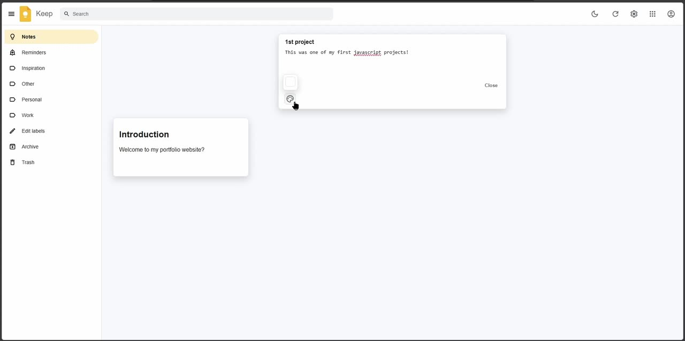
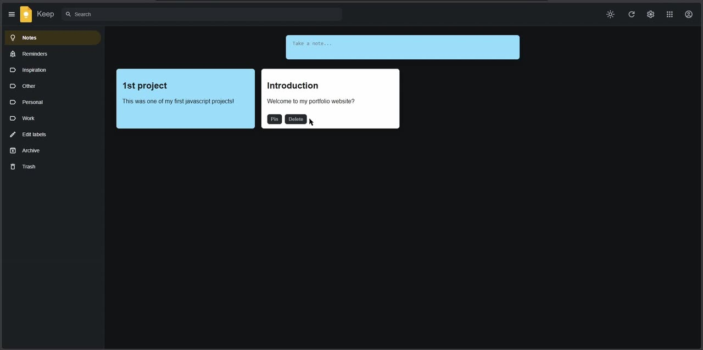

# Google Keep Clone

My version of Google Keep, built with HTML, CSS and plain JavaScript for a bootcamp assignment. I tried to get it looking as close to the real Google Keep as I could, and then added a few extras along the way, like picking any colour for a note and having the text colour sort itself out automatically.



## What it does

- Click the "Take a note…" bar and it expands into a full note with a title, just like Google Keep
- Saved notes show up as cards underneath, with **Pin** and **Delete** buttons (pinned notes stay at the top)
- Pick **any colour** for a note with the colour picker
- The text colour changes automatically depending on the background, so a note is still readable whether you pick a light or a dark colour
- A **dark mode** toggle
- Works on phones too



## Tech

- **HTML, CSS and vanilla JavaScript**
- Google's Material Symbols for the icons

## What's in here

```
Google-Keep-Assignment/
├── index.html      the layout: sidebar, search bar, note creator, notes area
├── style.css       the styling, dark mode and the mobile layout
├── index.js        creating, pinning and deleting notes, the colour picker, dark mode
└── resources/      the logo and icons
```

## Running it yourself

There's nothing to install. Just open `index.html` in your browser (or use Live Server in VS Code).

## Challenges I ran into (and how I fixed them)

**Text you couldn't read on dark colours.** Once the colour picker worked, picking a dark colour made the black text almost impossible to read. I wrote a small function that works out how bright the background colour is and switches the text to white or black to match, so any colour you pick stays readable.

**The colour picker didn't work at first.** I added the palette icon before it actually did anything. Getting it to open a picker, apply the colour to the note while you're still typing, and then carry that colour over to the saved note took a few tries.

**Long notes overflowing.** Notes with a lot of text were spilling out past the edges of their cards. I fixed the wrapping so long notes stay inside the card.

**Phones.** It looked good on my laptop but was cramped on a phone, so I went back and adjusted the layout for smaller screens.

## What I'd improve next

- **Save the notes.** Right now they disappear when you refresh the page. Saving them to `localStorage` would be the next step.
- Editing a note after it's been saved
- Making the search bar and the labels in the sidebar actually work
